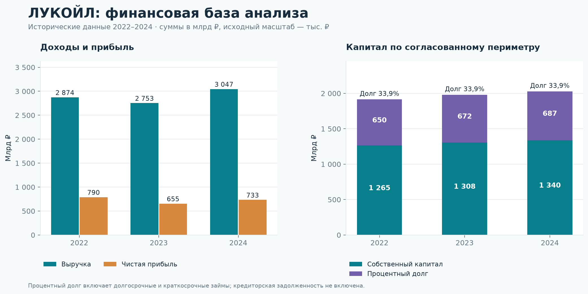
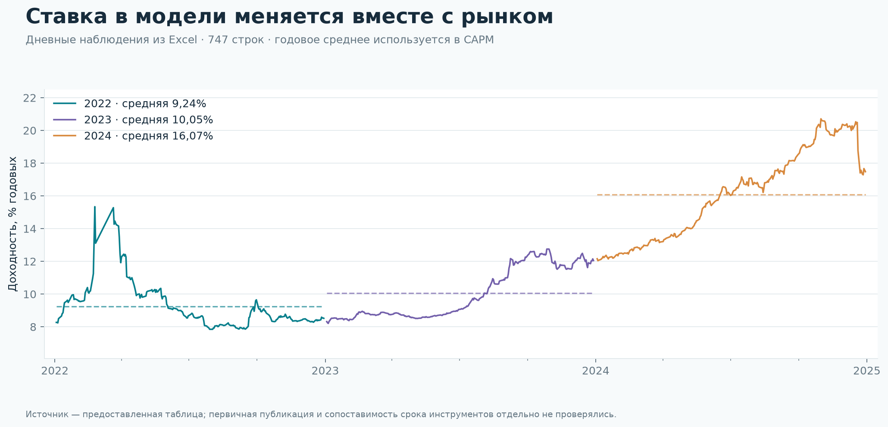
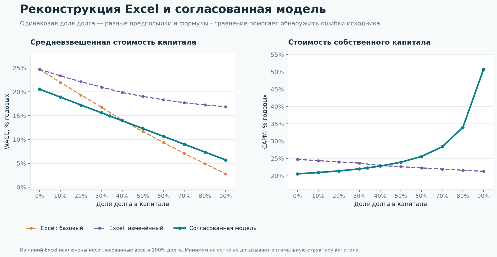
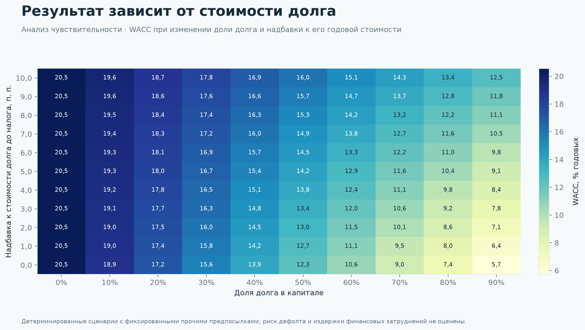

# Источники финансирования ЛУКОЙЛ: воспроизводимый анализ

Этот отчёт автоматически создан из таблиц Python. Он отделяет точное воспроизведение
формул Excel от аналитической модели с согласованным определением капитала.
Исходный материал — предоставленный учебный проект за 2022–2024 годы.
Первичные внешние публикации отдельно не сверялись; выводы относятся к данным и
предпосылкам проекта, а не ко всей группе компаний или текущей рыночной ситуации.

## Что показывают данные

- За 2022–2024 выручка изменилась на 6,02%, чистая прибыль — на -7,29%.
- Чистая рентабельность продаж изменилась с 27,49% до 24,04% (-3,45 п. п.).
- Доля процентного долга в выбранном периметре капитала изменилась с 33,93% до 33,90%.
- WACC в согласованной исторической модели изменился с 11,20% до 15,04% (3,84 п. п.).

Всего три годовых наблюдения описывают динамику, но не позволяют доказать причинные
связи, обучить убедительную прогнозную модель или оценить устойчивую долгосрочную тенденцию.

## 1. Исторические показатели

Денежные значения приведены в **млрд ₽**. Исходные числовые значения хранятся в
**тыс. ₽**; перевод в млрд ₽ выполняется делением на 1 000 000.

| Год | Выручка | Чистая прибыль | Чистая маржа | Собственный капитал | Процентный долг | Доля долга |
| --- | --- | --- | --- | --- | --- | --- |
| 2022 | 2 874,04 | 790,12 | 27,49% | 1 265,17 | 649,58 | 33,93% |
| 2023 | 2 753,48 | 655,29 | 23,80% | 1 308,07 | 671,71 | 33,93% |
| 2024 | 3 046,94 | 732,52 | 24,04% | 1 339,94 | 687,30 | 33,90% |

В согласованном историческом расчёте капитал = балансовый собственный капитал +
процентный долг. Процентный долг включает долгосрочные и краткосрочные займы.
Кредиторская задолженность и прочие непроцентные обязательства отдельно не становятся
стоимостью заёмного финансирования. Балансовые величины не заменяют рыночную оценку капитала.

## 2. Стоимость финансирования

| Год | Безрисковая ставка | CAPM | Долг после налога | WACC: согласованно | WACC: Excel | Разница, п. п. |
| --- | --- | --- | --- | --- | --- | --- |
| 2022 | 9,24% | 15,97% | 1,89% | 11,20% | 12,41% | -1,21 |
| 2023 | 10,05% | 17,59% | 0,71% | 11,86% | 14,35% | -2,49 |
| 2024 | 16,07% | 22,38% | 0,71% | 15,04% | 18,58% | -3,54 |

Различия между двумя WACC отражают определения долга, собственного капитала и
весов в исходных формулах. Они не означают ошибку выполнения Python: соответствие
исходным формулам проверяется в отдельном слое реконструкции.

Годовая безрисковая ставка — простое среднее доступных дневных наблюдений, без
взвешивания по времени. Доступность строк по годам различается.

| Год | Наблюдений | Средняя, % | Минимум, % | Максимум, % |
| --- | --- | --- | --- | --- |
| 2022 | 237 | 9,24 | 7,85 | 15,34 |
| 2023 | 254 | 10,05 | 8,21 | 12,75 |
| 2024 | 256 | 16,07 | 12,04 | 20,71 |

Историческая ставка налога — 20%; в сценарной модели — 25%, как в исходном
сценарном блоке. Стоимость долга после налога используется в WACC один раз:
повторное применение налогового щита не требуется.

## 3. Сценарии структуры капитала

Согласованная модель перебирает долю долга от 0% до 90% с постоянной суммой
капитала. CAPM использует фиксированную премию за рыночный риск, а бета пересчитывается
по формуле Хамады. Бета из исходного материала принята как сценарная входная
предпосылка: её интерпретация как бездолговой беты не подтверждена оценкой по рядам
доходностей. Поэтому результаты показывают действие формул при заданных предпосылках.

**100% долга исключено**: собственный капитал равен нулю, отношение D/E и ROE
не определены. NaN в этой строке — явный маркер недопустимой комбинации.

| Модель | Доля долга при минимуме на сетке | WACC | ROE |
| --- | --- | --- | --- |
| Расчет базовый | 90% | 2,81% | 355,89% |
| Расчет изменный | 90% | 16,89% | 355,89% |
| Согласованная модель | 90% | 5,73% | 361,34% |

Минимальный рассчитанный WACC в согласованной модели составляет 5,73%
при доле долга 90%. Это **минимум на заданной сетке**, а не
рекомендация по финансированию. Модель не оценивает вероятность дефолта, ковенанты,
доступность кредита, кредитный рейтинг, рыночную стоимость капитала и издержки финансовых
затруднений. При фиксированной низкой стоимости долга край сетки может механически
оказываться лучшим. Рост ROE при малом собственном капитале также может быть эффектом знаменателя.

## 4. Чувствительность к цене долга

При доле долга 90% увеличение надбавки с 0,0 до 10,0 п. п. изменяет WACC с 5,73% до 12,48%. Сетка позволяет оценить зависимость результата от входной
ставки, сохраняя остальные предпосылки. Надбавка прибавляется к стоимости долга
**до налога**, затем применяется налоговый щит.

Эта проверка не является стресс-тестом платёжеспособности: для него нужны прогноз
денежных потоков, график погашения и сценарии операционной деятельности.

## 5. Аудит исходной книги

- Проверено формул: **1104**; совпадений численных результатов: **1096**.
- Ожидаемых ошибок исходника: **8**; неожиданных расхождений: **0**.
- Численных расхождений не обнаружено. Проверка сравнивает результаты формул с сохранёнными значениями Excel; она подтверждает воспроизведение, но не корректность исходной методики.
- В сценарном базовом столбце встречаются веса капитала, сумма которых не равна 1. Такие точки не соединяются с корректными сценариями на графике.
- В исходных сценариях стоимость собственного капитала может снижаться с ростом долга. При положительной премии за риск и фиксированной бездолговой бете согласованная формула Хамады даёт противоположное направление.
- В сценарии 100% долга в Excel есть ошибки деления на ноль. Они сохранены как ожидаемые ошибки и не превращаются в численные результаты.
- Единицы в подписях учебного материала неоднородны. В Python масштаб каждого денежного поля указан в его имени и словаре данных.

| Лист | Столбец | Вес капитала | Вес долга | Сумма весов |
| --- | --- | --- | --- | --- |
| Расчет базовый | P | 78,73% | 34,39% | 1,1312 |
| Расчет изменный | P | 78,73% | 34,39% | 1,1312 |

Подробные формулы, источник данных и ограничения описаны в `../docs/`.
Таблицы результата и проверки сохраняются рядом с этим отчётом в CSV.

## Как воспроизвести

Из корня проекта запустите команду анализа из README или выполните
`../notebooks/01_financing_analysis.ipynb` от начала до конца. Расчёты, графики и этот
отчёт создаются общим pipeline; ручных числовых массивов в notebook нет.
